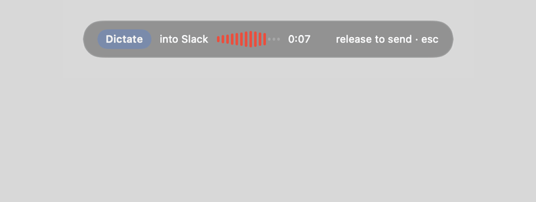
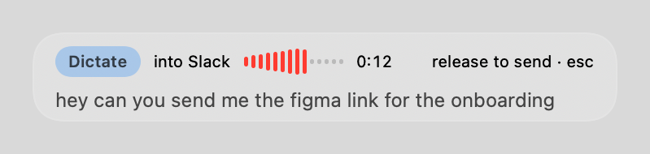
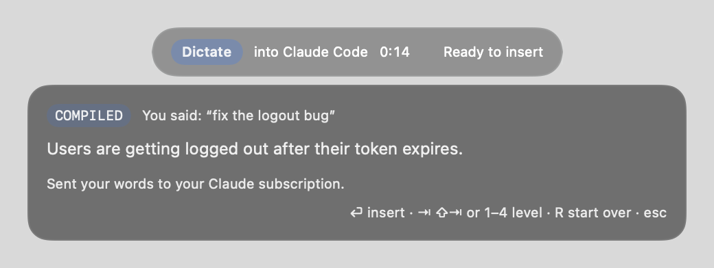
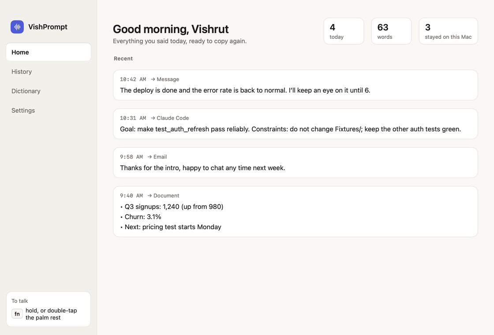
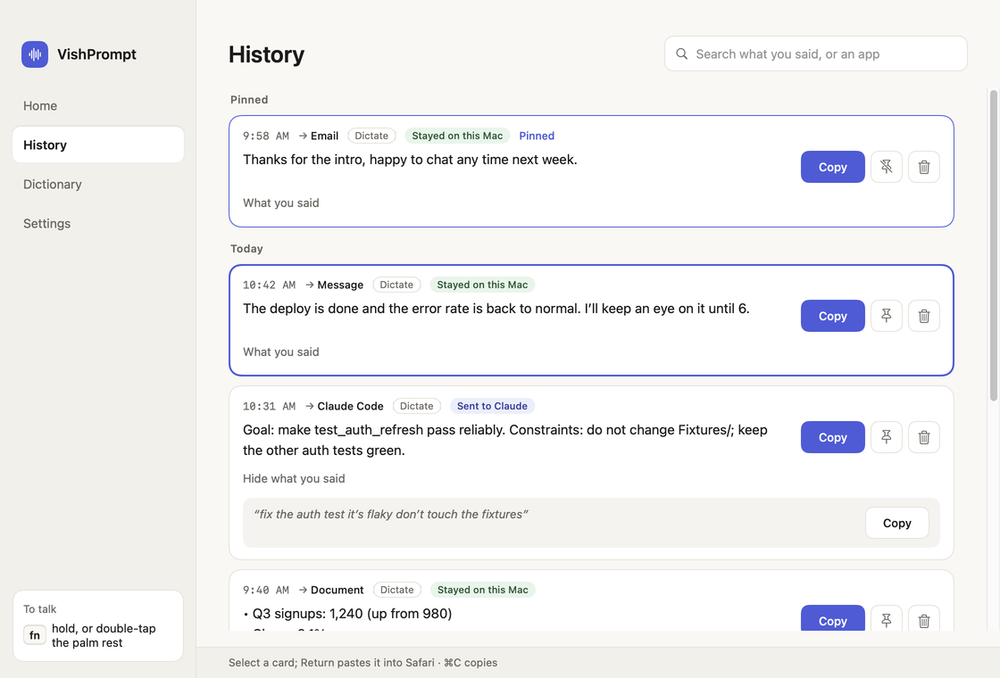
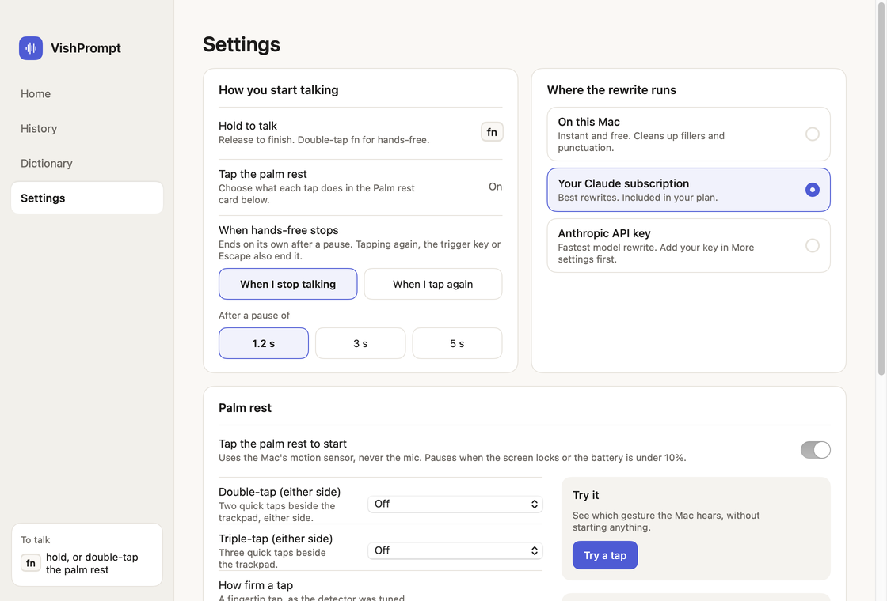
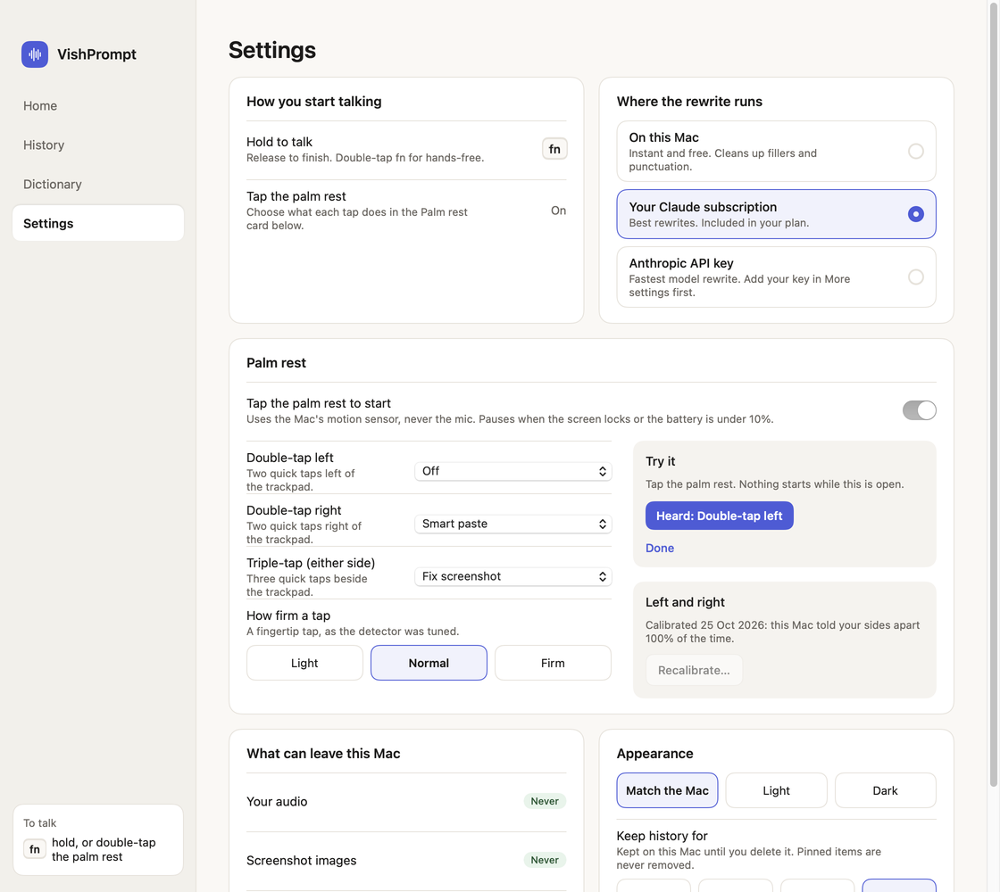

# VishPrompt

*Formerly Visprflow. The name changed because it read too much like Wispr Flow. The bundle identifier (`com.vish.visprflow`), the history file under `Application Support/Visprflow`, the Keychain entry and the saved settings keep the old internal name, so macOS keeps your permissions and your history stays.*

Hold `fn`, talk, release. The best possible prompt for wherever your cursor is lands in the
field. A prompt compiler for Claude Code, Cursor, claude.ai, Slack and email, running as a
native macOS menu bar app with on-device speech recognition.



*Rendered from the app's own SwiftUI views: you hold fn and talk, it rewrites, the card waits for Return, and the text lands.*

The plan, the research behind it and the phase breakdown are in [docs/plan.html](docs/plan.html).

## What it looks like

A small capsule hangs under the menu bar while you talk. It shows the mode, where the text is
going, the level, the time, and your words as they are heard. When something needs a decision,
a card drops below it: the compiled prompt, what you said, and what left your Mac.

| Talking | Deciding |
|---|---|
|  |  |

On a MacBook with a notch, the capsule splits into two black lobes either side of the camera
housing instead. Elsewhere it's the capsule above, and a notch is never drawn where there isn't
one. On macOS 26 the capsule and card are Liquid Glass when built with Xcode 26.

The menu bar icon follows along: a mic when ready, a waveform while recording, an ellipsis
while it works, a pause symbol when paused, and a warning triangle when setup is unfinished.

## The window

Press ⌘Y, or pick **Open VishPrompt…** from the menu bar. One window, in a warm light or dark
theme that follows the Mac unless you choose: Home, History, Dictionary and Settings.

| Home | History |
|---|---|
|  |  |

- **Every dictation is a card:** the time, the app it went to, how it was made (dictate, Smart
  Paste, edit by voice, screenshot fix), and **"Stayed on this Mac"** or **"Sent to Claude"**
  from what the app recorded at the time. **Copy** copies the result and says *Copied*; **What
  you said** opens the raw words with their own Copy; pin floats a card to the top; delete
  removes it, with Undo.
- **History** searches the result, what you said, the app and the mode, grouped by Today,
  Yesterday and dates. Select a card and press Return to paste it again into the app you came
  from; ⌘C copies it.
- **Home** greets you, counts today from real rows (dictations, words, how many stayed on this
  Mac), shows today's latest, and once an app has ten dictations in a week, says how each app
  is going: how many, and the share you took as they came.
- **Dictionary** shows the words VishPrompt spells your way: today, the file names and
  identifiers read from the git repo you dictate into, read-only. There is no list of your own
  words yet, and the page says so.
- **Keep history for** 30, 60 or 90 days, or forever. Pinned cards are never removed; a
  shorter period asks first with the real count; the file's size on disk is shown.

## Settings

| Settings | Palm rest |
|---|---|
|  |  |

- **How you start talking:** the trigger key, and **when hands-free stops**: on its own after
  a pause of 1.2, 3 or 5 seconds, or only when you tap again. The capsule says which.
- **Where the rewrite runs:** on this Mac, your Claude subscription, or an API key.
- **What can leave this Mac:** your audio, never; screenshot images, never; your words, only
  when a rewrite needs them, and nothing at all when everything runs on this Mac.
- **Writing rules per app:** every app or site you dictate into, each with its own rule in your
  own words ("no greetings, lowercase is fine"), sent with each rewrite for that app. An app
  with no rule uses its family's. Nothing here changes on its own.
- **Appearance:** match the Mac, light, or dark.

### The palm rest

An optional second trigger, **off by default**: double-tap the aluminium beside the trackpad
and a hands-free dictation starts. It reads the MacBook's motion sensor, **never the
microphone**, and needs no extra permission. Taps while you type, click, scroll or touch the
trackpad are ignored; so is the Mac being picked up or set down. It pauses when the screen locks
or the battery is under 10%, and costs well under 1% of a core while on.

- **Choose what each gesture does:** double-tap, triple-tap, and, once a calibration has shown
  your Mac can tell them apart, double-tap left and double-tap right. Each runs Dictate, Smart
  Paste, Edit selection by voice or Fix screenshot, the same as the keys would. A side is never
  guessed: if the calibration can't separate your sides on the surface you're on, you get one
  either-side gesture and the reason.
- **How firm a tap**, light to firm, and a **Try it** area that shows the gesture it heard
  without starting anything.
- It needs an M2 or later MacBook. On a Mac without the sensor the card says so.

It was tuned on real recordings; on a soft surface such as a bed, light taps are the size of the
Mac's own resting noise, so tap firmly there.

## The trigger key

`fn` by default. Right Option, Right Command and the F-keys can be chosen instead. **Left
Command, Left Option, both Controls and both Shifts are refused**, with the reason: they are
used all day for shortcuts, and holding one to talk would turn each ⌘C or ⌘V into a dictation.
A key pressed right after the trigger is treated as a shortcut, not a dictation, and goes
through untouched. Settings says when macOS also acts on the Globe key, with a link to fix it.

## Status

Phases 0 through 3 are built, plus most of the phase 4 and 5 polish. Every change lands with
its tests (`make test`), and the slower suites (speech, OCR, latency, a live sign-in) have their
own `make verify-*` targets. The app is installed at `~/Applications/VishPrompt.app`.

| Working | Not yet |
|---|---|
| Hold-to-talk, double-tap for hands-free, Escape to cancel | Streaming cloud speech recognition (phase 4) |
| On-device transcription with Parakeet v3 | Groq as a faster rewrite provider |
| Three rewrite providers: local, subscription, API key | Snippets and a prompt library |
| Destination detection, per-destination and per-app instructions | Notarised distribution and Sparkle updates |
| Prompt compilation with guardrails and a raw fallback | Selected text and screen text as automatic context |
| Preview with Return to insert, Tab to change level | A list of your own dictionary words |
| Smart Paste: hold the trigger, press V, say how | Learning from your edits (deliberately not built) |
| Edit a selection: hold the trigger, press R, say how | |
| Screenshots read on this Mac into bug prompts | |
| The Home window: History with copy, pin, search and paste again; Dictionary; Settings | |
| Palm-rest gestures from the motion sensor, with calibration and a Test area | |
| History kept for 30, 60 or 90 days, or forever | |
| Repository vocabulary from your git workspace | |

## What you have to do first

Two permissions, granted once, in the setup window that opens on first launch:

| Grant | Used for |
|---|---|
| Microphone | Recording while the key is held. Audio never leaves the Mac. |
| Accessibility | Pasting into the focused app and watching for the trigger key. |

Input Monitoring is not needed: Accessibility already lets the app see the trigger key. The
palm-rest sensor needs no permission either.

Two more things worth doing in that window:

- **Set the fn key to "Do Nothing"** in System Settings, Keyboard. macOS handles the emoji
  picker before any app sees the key. The setup window and Settings detect this and link
  straight there. On an external keyboard, switch the trigger to Right Option instead: `fn`
  only reaches apps from the built-in keyboard.
- **Choose where rewrites go.** Three options, and the default mixes them:

  | Provider | Speed | Cost |
  |---|---|---|
  | On this Mac | instant | free |
  | Your Claude subscription | 3 s to first word, 6–10 s total | included in your plan |
  | Anthropic API key | 0.7 s to first word, 1–2 s total | roughly $0.002 per dictation |

  The default keeps quick cleanup local and sends compiled prompts to your subscription, so
  nothing costs extra and the common path stays instant. Local cleanup handles fillers,
  stutters, spoken punctuation and capitalisation. It does not attempt self-corrections, so
  a transcript containing "no wait" or "scratch that" is handed to a model automatically.

Launch from `~/Applications`, not from `build/`. Debug builds are ad-hoc signed, so macOS ties
the grants to the exact binary and every rebuild loses them.

## How it behaves

| Where your cursor is | What you get |
|---|---|
| Terminal running `claude` or `codex` | A structured prompt: goal, symptom, files you named, constraints, verification. Preview first, Return to insert. |
| Cursor, VS Code, Zed, Windsurf | The same, for the agent chat pane. |
| claude.ai, ChatGPT, Gemini, Perplexity | One clear ask with your context, inserted straight away. |
| Slack, iMessage, WhatsApp, Discord | Light cleanup that keeps your register, lowercase included. |
| Mail, Gmail, Superhuman | The ask in the first sentence, short paragraphs. |
| A shell prompt with no agent | Exactly what you said. Never capitalised, never punctuated. |
| A password field, or Terminal with Secure Keyboard Entry | Nothing is inserted. The overlay says so and the transcript goes to your clipboard. |

Hold `shift` with the trigger for verbatim, `control` for a full compile. Say "verbatim:" or
"prompt mode" to do the same with your voice.

## Smart Paste

Copy something, then hold the trigger and press `V` within a second. Say how you want it
pasted ("as bullet points", "shorter", "ask Claude why this fails"), or say nothing, and release.
The preview shows the result. Return pastes it, Tab flips between rewritten and as copied, and
Escape cancels. Your clipboard is put back afterwards, so what you copied never changes.

| What you do | What happens |
|---|---|
| Say nothing | The clip is pasted as copied. Nothing is sent anywhere. Into Claude Code, Cursor, Codex or a chat window, a multi-line clip is fenced and labelled as pasted data, and known secret shapes are replaced with `[redacted …]`. |
| Say an instruction | The clip goes to your compile-path provider with known secret shapes removed first. The first time for each provider, the overlay asks before sending anything. |
| Paste into a shell | Always exactly as copied, whatever you said. |
| Copy a password | A clip marked concealed by a password manager is never read. |
| Copy something huge | Over 20,000 characters is pasted as copied and never sent. |

With the compile path set to "On this Mac", an instruction cannot be followed and nothing is
sent. The overlay says so.

### Editing a selection

Select text in any app, hold the trigger, press `R` within a second, and say what to do with it:
"shorter", "make it a bug report", "reply no politely". The preview shows the rewrite. Return
replaces the selection, Escape leaves it untouched, and ⌘Z in the app brings the original back.
It works the way Smart Paste does: the selection is sent only with your instruction, after
consent, with known secret shapes removed. The selection is read through Accessibility, or by a
⌘C that puts your clipboard back. Terminals and secure fields are refused.

### Screenshots

Copy a screenshot of an error (⌘⌃⇧4 copies a selection), then in Claude Code, Cursor or Codex
hold the trigger and say "fix this". If the screenshot was copied in the last two minutes, its
text is read on this Mac with Apple's Vision framework and appended to the prompt, fenced and
labelled as data, with known secret shapes redacted. **The image never leaves the Mac, and the
screenshot text is never sent to the rewrite model**: the model only sees what you said, and
the text is added afterwards. Tab drops or restores the screenshot text; hold Shift to leave
it out. Fn+V with a screenshot does the same at any age. In any other app, fn+V pastes the
screenshot's text as a Smart Paste clip.

## Requirements

- macOS 15 or later, Apple Silicon
- Xcode 16.3 or later
- [XcodeGen](https://github.com/yonaskolb/XcodeGen): `brew install xcodegen`

## Build and run

```bash
make install              # Release build into ~/Applications (launch from there)
make test                 # unit tests, about a minute
make verify-stt           # speech tests against audio from `say`; needs no microphone
make verify-ocr           # Vision OCR against the committed screenshots in Fixtures/ocr
make verify-sensor        # reads the real palm-rest sensor; needs an M2 or later MacBook
make verify-subscription  # drives the real `claude` CLI; spends subscription quota
make record-taps SURFACE=desk   # guided recording of taps, typing and clicks into Fixtures/taps/
make logs                 # stream the app's own log
```

`project.yml` is the source of truth; the `.xcodeproj` is generated and git-ignored.

## Layout

```
project.yml              XcodeGen definition
VishPrompt/
  App/                   @main, app delegate, observable app state
  Core/Hotkey/           Gesture state machine, CGEventTap, trigger key, secure input
  Core/Tap/              Palm-rest sensor, tap detector, gestures, side calibration
  Core/Audio/            Capture, ring buffer, file loading
  Core/STT/              Transcriber protocol, Parakeet via FluidAudio
  Core/Compile/          Levels, system prompt, Claude client, guardrails
  Core/Destination/      Destination model, resolver, focus context, app identity, per-app rules
  Core/Context/          Workspace probe, repository vocabulary
  Core/Insert/           Paste with clipboard restore, keycode resolution
  Core/Paste/            Smart Paste and screenshots: clipboard, redactor, OCR, prompts
  Core/Pipeline/         DictationController, the orchestrator
  Core/Storage/          GRDB history, timings, retention, outcome signals
  UI/                    Menu bar, setup window, overlay, the Home window, settings
VishPromptTests/          XCTest target
Fixtures/golden/         Messy transcript to expected output cases
Fixtures/taps/           Real palm-rest recordings the tap detector is tested on
docs/plan.html           The plan
```

## Privacy

Audio never leaves the machine. The only thing sent anywhere is the transcript, the vocabulary
list, the destination name and your own instruction (the family's, or the app's own writing
rule), and only when an edit level above verbatim applies and the provider for that level is not
local. Set both providers to "On this Mac" and nothing leaves at all.

Smart Paste adds one thing to that list: **the clipboard text**, and only when you speak an
instruction. It goes to the compile-path provider after you have allowed it once for that
provider. Before it goes, known secret shapes are swapped for placeholders on this Mac: API
keys and tokens, JWTs, private key blocks, passwords in URLs and headers, `password = …`
assignments, and long random strings. For a message, email or document the real values are
put back locally once the model returns. For Claude Code, Cursor, Codex and chat windows they
stay redacted, because those destinations are models too. "Known shapes" is the claim: a
password written in a sentence is not caught, and
[Fixtures/secrets/known-misses.json](Fixtures/secrets/known-misses.json) lists what else is not.
History keeps only the redacted form. Every dictation is stored locally in
`~/Library/Application Support/Visprflow/visprflow.sqlite` together with the exact request that
was sent, so the claim is inspectable rather than promised.

The same file keeps, for each dictation, which app or site it went to and what happened next:
the first key you pressed on the preview, the levels you tried, whether you undid it within 30
seconds, and copies and paste-again from History. That is what Home's "how each app is going"
counts. It stays on this Mac, nothing learns from it, and deleting a dictation deletes it. The
palm-rest sensor's readings are used only to spot a tap and are not kept.

## Licence

MIT. See [LICENSE](LICENSE).

## Git workflow

`main` receives only `dev`. Feature branches start from the latest `dev` and return to it by
pull request after a rebase. Branches are never deleted.
